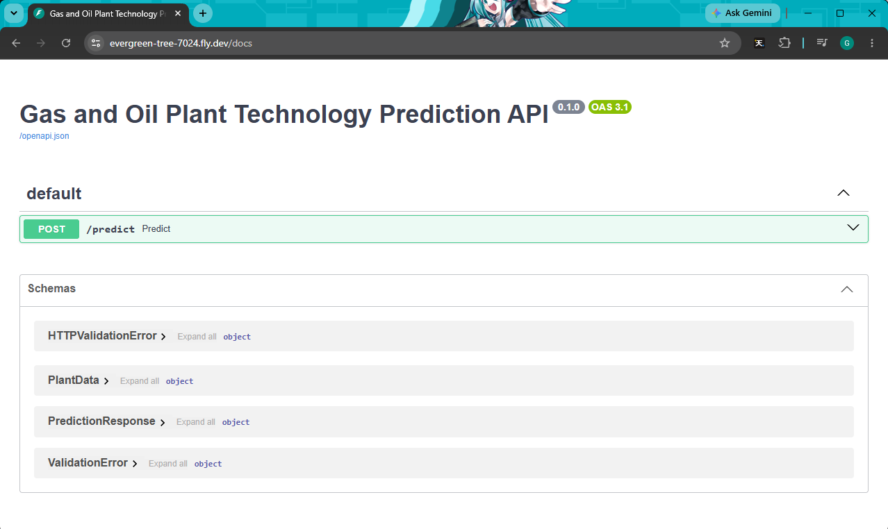
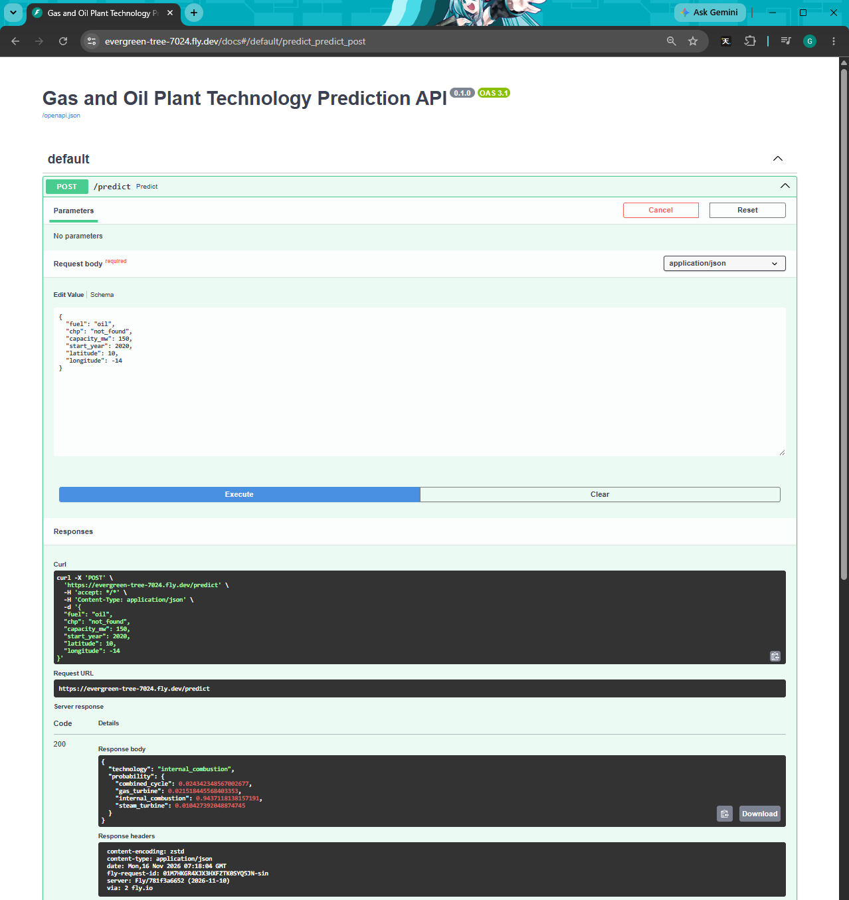

**Project Name:** Predicting oil and gas plant technologies based on data from the Global Energy Monitor's Global Oil and Gas Plant Tracker

**By:** Gemfriel Dela Cruz

**For:** Midterm project for the Datatalks Club Machine Learning Zoomcamp, 2026 cohort

**Data source:** Global Energy Monitor, [Global Oil and Gas Plant Tracker](https://globalenergymonitor.org/projects/global-oil-gas-plant-tracker), August 2026 (CC BY 4.0). The file is committed in the 'data/' folder.

**About the data set:** The Global Oil and Gas Plant Tracker maintained by the Global Energy Monitor (GEM) is a publicly available worldwide dataset of oil- and gas-fired power plants. Its latest update was published in August 2026, and it is the version of the data set used for this project. 

**Background:** The power generation sector has become an essential sector of modern society considering the current generation's inescapable reliance on electricity. Within the sector, the oil and gas subsector comprises a significant share of global power generation, making it a key player whose movements cannot be overlooked. However, the subsector brings with it its own hosts of problems due to its traditional association with non-renewable means of producing power. These include introducing pollution, causing resource depletion, and significantly contributing to global warming, to name a few. 

As such, it is important to have as much information as possible to ensure that regulators and decision-makers put proper guardrails in place for this subsector, while not compromising the satisfaction of humanity's energy needs. However, not all data sources are perfect, and even the best sources can lack important information that may be required to properly manage them.

This extends to the chosen data set. Upon examination, 3% (426 of 14099) of the units in the Global Oil and Gas Plant Tracker have an 'unknown' technology. 

**Problem:** Given the characteristics of the data set, there is thus an opportunity to train a machine learning algorithm to predict what a unit's technology will be.

Specifically, given a unit's fuel, CHP, capacity (in MW), start year, latitude, and longitude values, the model will be able to predict its technology as one of four possible values: combined_cycle, gas_turbine, steam_turbine, or internal_combustion, via multiclass classification and with Macro F1 as the metric. 

In a real-world scenario, a researcher could use this service to determine what a unit's likely technology is provided they know its other characteristics.

**Files:**
* notebook.ipynb - Jupyter notebook that covers an explanation of the problem, data preparation, EDA, feature importance, and model selection and tuning
* train.py - Python script that trains the final model and saves it to "model.bin"
* model.bin - the model outputted by train.py
* predict.py - Python script that loads "model.bin" and serves it via FastAPI
* Dockerfile - container for the whole service
* pyproject.toml, uv.lock, .python-version - required dependencies and Python version
* .dockerignore, fly.toml - container and deployment configuration files
* data/ - contains the raw data for the project
* images/ - contains three screenshots showing proof of deployment over fly.io

**Getting the code:**
```bash
git clone https://github.com/Gylmine/machine-learning-zoomcamp-2026.git
cd machine-learning-zoomcamp-2026/midterm
```
Alternatively, use the green "Code" button on the repository page, click on "Download ZIP", extract contents, and then open the "Midterm" folder.

**How to run without Docker:**
Note: all files live in the midterm/ folder and as such all commands must be run from there.
1. Install uv (https://docs.astral.sh/uv/).
2. In terminal, enter the following commands in sequence:

```bash
cd midterm
uv sync     
source .venv/bin/activate        
uv run python train.py   
uv run uvicorn predict:app --host 0.0.0.0 --port 9696
```

3. Open http://localhost:9696/docs in a browser to bring up the UI generated by FastAPI.
4. Click on "POST /predict" and then "Try it out".
5. Edit the Request body and provide the desired information:
    * fuel: 'gas', 'oil', 'lng_only', or 'multi_fuel'
    * chp: 'yes', 'no', or 'not_found'
    * capacity_mw: value only (in megawatts)
    * start_year: yyyy value, or 0 if unknown
    * latitude: value only (can be negative, meaning below the equator)
    * longitude: value only (can be negative, meaning west of the prime meridian)
6. Click "Execute".
7. If done correctly, the server response (200) will show the following:
    * technology: predicted technology, i.e., the technology with the highest probability score
    * probability:
        * combined_cycle: the probability of the unit employing combined cycle technology
        * gas_turbine: the probability of the unit employing gas turbine/s
        * steam_turbine: the probability of the unit employing steam turbine/s
        * internal_combustion: the probability of the unit employing internal combustion

**How to run with Docker:**
Note: model.bin, which Docker will need, is already included in the repository. If desired, it can be recreated by first running "uv run python train.py" before executing #1 below.

1. In terminal, enter the following commands in sequence:
    
```bash
cd midterm
docker build -t power-unit-technology .
docker run -it --rm -p 9696:9696 power-unit-technology
```

2. Repeat steps #3 to #7 of the procedure without Docker (see above).

**Deployment:**
If desired, the service may be deployed over any cloud platform including fly.io. 

As part of the exercise, the service was temporarily deployed on fly.io with the URL "evergreen-tree-7024.fly.dev". These were the steps followed to deploy it:

```bash
curl -L https://fly.io/install.sh | sh
fly auth signup
cd midterm
fly launch --generate-name --internal-port 9696
fly deploy
```

The following screenshots show the service running over the cloud, although it was destroyed after screenshots were taken (via the command "fly apps destroy evergreen-tree-7024") and it is no longer accessible:

The API documentation page as hosted on fly.io:


Proof of the service running correctly after sending an example request:


Further proof of the service running correctly after sending another example request:


**Citation:** Global Energy Monitor, Global Oil and Gas Plant Tracker, August 2026 release.